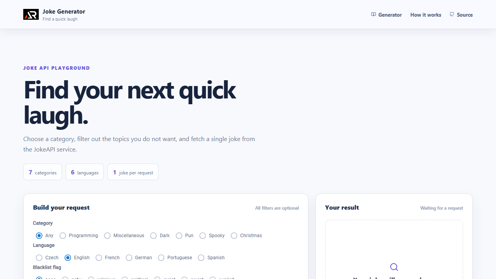

# Joke Generator

A responsive React playground for finding a single joke through the JokeAPI service. Choose a category, language, blacklist flag, and optional search phrase before sending a request.



## Features

- Category, language, and blacklist filters
- Optional phrase search
- Loading, error, empty, and success states
- Copy joke and retry actions
- Responsive header, footer, and back-to-top control

## Tech stack

- React 18
- Create React App
- Material UI
- Sass modules
- Fetch API and React Icons

## Run locally

```bash
npm install
npm start
```

Create a production build with `npm run build`.

## Live URL

[https://a2rp.github.io/joke-generator/](https://a2rp.github.io/joke-generator/)

## Future prospects

- Add a multi-joke result mode
- Save favourite jokes locally
- Add a dedicated history view

## Links

- Portfolio: [https://www.ashishranjan.net/](https://www.ashishranjan.net/)
- GitHub: [https://github.com/a2rp](https://github.com/a2rp)
- CodePen: [https://codepen.io/ash1198](https://codepen.io/ash1198)
- LinkedIn: [https://www.linkedin.com/in/aashishranjan](https://www.linkedin.com/in/aashishranjan)
- Facebook: [https://www.facebook.com/theash.ashish/](https://www.facebook.com/theash.ashish/)
- YouTube: [https://www.youtube.com/@ashishranjan-ashz?sub_confirmation=1](https://www.youtube.com/@ashishranjan-ashz?sub_confirmation=1)
- Email: [ash.ranjan09@gmail.com](mailto:ash.ranjan09@gmail.com)

## Support

- Support: [https://a2rp-donation-page.netlify.app/](https://a2rp-donation-page.netlify.app/)
- Buy Me a Coffee: [https://buymeacoffee.com/a2rp](https://buymeacoffee.com/a2rp)
- Patreon: [https://www.patreon.com/a2rp](https://www.patreon.com/a2rp)
